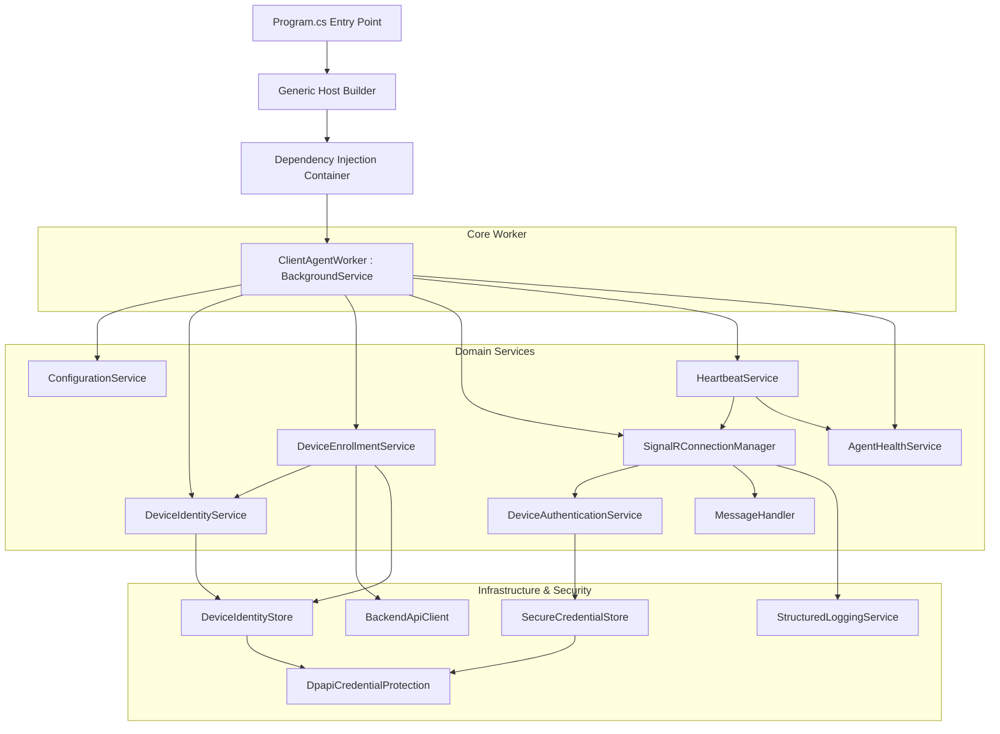

# Module 01: Project Architecture & System Overview

## 1. System Context & Purpose

The **Gaming Cafe Management System Client Agent** (`GamingCafe.ClientAgent`) is a mission-critical, secure background worker application written in **C# / .NET 10**. It is designed to run locally on client gaming stations (PCs) within an esports arena, internet cafe, or gaming center.

```mermaid
flowchart TD
    subgraph Client Station ["Client PC (Gaming Station)"]
        CA[GamingCafe Client Agent]
        DI[Device Identity & DPAPI Store]
        FL[Structured File Logger]
    end

    subgraph Backend Server ["Gaming Cafe Central Backend (ASP.NET Core Web API)"]
        API["REST API (/api/devices/register)"]
        HUB["SignalR Agent Hub (Future: /hubs/agent)"]
        DB[(PostgreSQL Database)]
    end

    CA -->|1. POST /api/devices/register| API
    CA -.->|2. WSS Real-Time Socket (Dormant)| HUB
    CA -->|Local Encrypted Storage| DI
    CA -->|Local Rolling Logs| FL
    API --> DB
    HUB --> DB
```

### Core Responsibilities of the Client Agent
1. **Station Identity Management**: Uniquely and deterministically identifies the local gaming PC using hardware attributes and cryptographic keys, persisting identity securely on Windows via the **Data Protection API (DPAPI)**.
2. **Backend Enrollment**: Discovers and registers the local PC with the central management backend via REST API (`POST /api/devices/register`).
3. **Session & Security Telemetry**: Collects system health metrics (CPU, RAM, network latency) and prepares telemetry.
4. **Bi-Directional Command & Control**: Incorporates a production-ready **SignalR WebSocket (WSS)** transport layer to listen for administrative commands (remote lock, unlock, shutdown, restart, billing notifications) and stream real-time heartbeats.
5. **Resilient Local Operation**: Operates autonomously under network partitions, employing exponential backoff with jitter and graceful degradation.

---

## 2. Directory Structure & Layered Architecture

The project adheres to Clean Architecture and Separation of Concerns principles, organizing functionality into distinct domain folders under `src/GamingCafe.ClientAgent/`:

```
GamingCafe-ClientAgent/
├── src/
│   └── GamingCafe.ClientAgent/
│       ├── Authentication/          # Token management and secure credential storage
│       ├── Communication/           # REST API client and SignalR connection engine
│       ├── Configuration/           # Strongly typed settings and validation rules
│       ├── Enrollment/              # Device registration and onboarding orchestration
│       ├── Health/                  # System metrics and agent health diagnostics
│       ├── Heartbeat/               # Bi-directional ping/pong heartbeat tracking
│       ├── Identity/                # Hardware identity generation and DPAPI storage
│       ├── Logging/                 # Rolling file logging and structured formatting
│       ├── Messaging/               # Protocol contracts, enums, and message dispatching
│       ├── Security/                # DPAPI encryption, TLS validation, and log masking
│       ├── Services/                # Background worker service (IHostedService entry point)
│       ├── appsettings.json         # Base configuration (Production-grade HTTPS/WSS defaults)
│       ├── appsettings.Development.json # Development configuration (HTTP fallback)
│       └── Program.cs               # Host builder, DI container composition, and bootstrapping
├── tests/
│   └── GamingCafe.ClientAgent.Tests/ # 14 test classes containing 56 xUnit unit/integration tests
└── Documentation/
    └── Codebase-Walkthrough/        # 11-part architectural and technical walkthrough guide
```

---

## 3. Detailed Responsibility Map

| Directory / Module | Key Interfaces & Classes | Primary Architectural Responsibility |
| :--- | :--- | :--- |
| **`Services/`** | `ClientAgentWorker` | The main `BackgroundService` executing the agent lifecycle: configuration check, identity load, enrollment, and runtime loop. |
| **`Configuration/`** | `AgentConfiguration`, `ConfigurationService`, `ConfigurationValidator` | Implements immutable configuration binding, deep validation (rejects HTTP in production, validates timeouts), and hot-reload support. |
| **`Identity/`** | `IDeviceIdentityService`, `DeviceIdentityStore`, `DeviceIdentity` | Generates unique station identifiers (`PC-XXXXXXXX`), retrieves MAC/IP addresses, and manages corrupted identity quarantine. |
| **`Security/`** | `DpapiCredentialProtection`, `SecurityValidationService`, `SecurityMasker` | Encrypts secrets at rest using Windows DPAPI, enforces TLS 1.2/1.3 certificate validation, and redacts sensitive tokens in log outputs. |
| **`Authentication/`** | `DeviceAuthenticationService`, `SecureCredentialStore` | Manages backend device credentials, session tokens, and SignalR access token provider callbacks. |
| **`Enrollment/`** | `DeviceEnrollmentService`, `IDeviceEnrollmentService` | Orchestrates the station onboarding lifecycle: verifies identity, invokes REST registration, and handles conflict / approval states. |
| **`Communication/`** | `BackendApiClient`, `SignalRConnectionManager`, `ConnectionStateManager`, `ReconnectionService` | Manages outgoing HTTP REST requests and maintains resilient, auto-reconnecting WSS SignalR connections. |
| **`Heartbeat/`** | `HeartbeatService`, `IHeartbeatService` | Dispatches monotonic ping heartbeats over SignalR, tracks server ACK latencies, and triggers reconnection upon missed thresholds. |
| **`Messaging/`** | `MessageHandler`, `ProtocolMessages`, `ProtocolEnums` | Decodes incoming JSON payloads and dispatches commands to strongly-typed registered handlers. |
| **`Health/`** | `AgentHealthService`, `AgentHealthSnapshot` | Samples memory working set, CPU load, uptime, and communication states for observability. |
| **`Logging/`** | `FileLoggerProvider`, `FileLogger`, `StructuredLoggingService` | Provides lock-free, circular-dependency-free asynchronous rolling file logging to disk. |

---

## 4. Layer Interaction & Dependency Flow



---

## 5. Architectural Quality Attributes & Guarantees

1. **Zero Unprotected Secrets**: All credentials, tokens, and hardware identity tokens stored on the client disk are encrypted using Windows DPAPI with `DataProtectionScope.CurrentUser`. Plaintext secrets never touch the file system.
2. **Defensive Log Masking**: `SecurityMasker` intercepts and sanitizes log streams, stripping Bearer tokens, passwords, and private keys using pre-compiled regex filters.
3. **Strict Production Security Hardening**: The agent will refuse to boot in non-development environments if TLS certificate validation is disabled or if non-WSS/non-HTTPS endpoints are configured.
4. **Resilient Decoupling**: If the backend REST API or SignalR hub is offline, the agent enters an exponential backoff loop with jitter, preserving station CPU cycles and avoiding self-inflicted denial-of-service (DoS) on the server.
