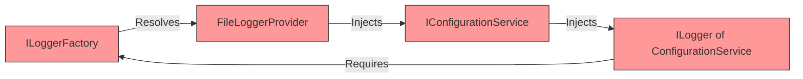
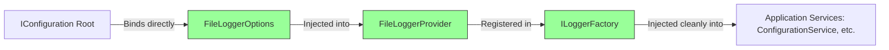
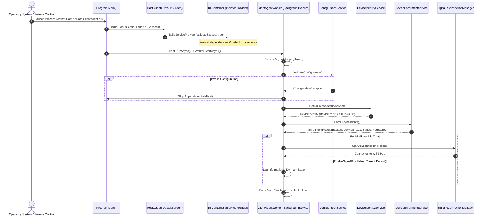

# Module 02: Startup & Dependency Injection

## 1. The .NET Generic Host Architecture

The Client Agent is built on the modern **.NET 10 Generic Host** (`Microsoft.Extensions.Hosting`). The Generic Host encapsulates:
- Dependency Injection (`IServiceCollection` / `IServiceProvider`)
- Configuration System (`IConfiguration` with JSON, Environment, and CLI sources)
- Logging Infrastructure (`ILoggingBuilder`, `ILoggerFactory`)
- Application Lifetime Management (`IHostApplicationLifetime`, cancellation tokens)
- Hosted Services (`IHostedService` / `BackgroundService`)

### Entry Point Anatomy (`Program.cs`)
The startup routine in `Program.cs` is divided into four distinct phases:
1. **Configuration Pre-Load & Logging Initialization**
2. **Host Builder Configuration** (Configuration sources, Logging providers)
3. **Dependency Injection Service Registration**
4. **Host Build, Verification & Execution**

---

## 2. Resolving the Circular Dependency Dilemma

### The Problem
During early development, the application encountered fatal startup exceptions:
```
System.InvalidOperationException: A circular dependency was detected for the service of type 'Microsoft.Extensions.Logging.ILoggerFactory'.
  ILoggerFactory -> FileLoggerProvider -> IConfigurationService -> ILogger<ConfigurationService> -> ILoggerFactory
```



### The Architectural Root Cause
- The logging system needs to initialize *before* or *during* container build.
- `FileLoggerProvider` needed to know the log directory path and minimum log level.
- To obtain these settings, `FileLoggerProvider` was injecting `IConfigurationService`.
- But `ConfigurationService` was injecting `ILogger<ConfigurationService>` to log configuration loading warnings.
- Thus, resolving the logger factory required resolving the configuration service, which required resolving the logger factory!

### The Solution: Independent Options & Decoupled Initialization
1. **Removed `IConfigurationService` from `FileLoggerProvider`**: The logging provider now accepts an independent, immutable `FileLoggerOptions` instance.
2. **Pre-extracted Options**: In `Program.cs`, before constructing the DI container, configuration is bound directly from the raw `IConfiguration` to `FileLoggerOptions`.
3. **Zero `ILogger` inside Logging Providers**: `FileLoggerProvider` and `FileLogger` write directly to disk or fallback to `Console.Error` without invoking `ILogger`.
4. **Registration Decoupling**:
```csharp
// Program.cs - Decoupled file logger registration
var fileLoggerOptions = new FileLoggerOptions
{
    LogDirectory = logDirectory,
    FileNamePrefix = "client-agent-",
    MinLevel = LogLevel.Information,
    RetainDays = 7
};
logging.AddProvider(new FileLoggerProvider(fileLoggerOptions));
```



---

## 3. Dependency Injection Service Lifetimes

The DI container registers services with explicit lifetimes based on statefulness, thread-safety, and resource management:

| Service | Registered Lifetime | Justification & Architectural Reason |
| :--- | :--- | :--- |
| `IConfigurationService` | **Singleton** | Configuration is immutable or refreshed globally; holds cached settings. |
| `ICredentialProtector` (`DpapiCredentialProtection`) | **Singleton** | Stateless crypto wrapper calling Windows Win32 DPAPI functions. |
| `ISecurityValidationService` | **Singleton** | Evaluates TLS rules and hardening requirements using thread-safe logic. |
| `IDeviceIdentityStore` (`DeviceIdentityStore`) | **Singleton** | Coordinates file I/O for `device-identity.dat` and in-memory caching. |
| `IDeviceIdentityService` (`DeviceIdentityService`) | **Singleton** | Generates and retains the station's hardware identity throughout the process life. |
| `ISecureCredentialStore` | **Singleton** | Encrypted token storage with in-memory thread-safe cache. |
| `IDeviceAuthenticationService` | **Singleton** | Manages credentials, tokens, and provides tokens for SignalR handshakes. |
| `IBackendApiClient` (`BackendApiClient`) | **Singleton** | Manages an underlying `HttpClient` instance. Singleton prevents socket exhaustion. |
| `IDeviceEnrollmentService` | **Singleton** | Manages registration state transitions across the lifetime of the station. |
| `IConnectionStateManager` | **Singleton** | Thread-safe state machine tracking SignalR connection status. |
| `IReconnectionService` | **Singleton** | Stateless backoff algorithm generator with full jitter. |
| `IMessageHandler` (`MessageHandler`) | **Singleton** | Registry of message types to delegate handlers. |
| `ISignalRConnectionManager` | **Singleton** | Holds the active `HubConnection` instance and connection lock. |
| `IHeartbeatService` | **Singleton** | Drives the ping loop and tracks monotonic sequence numbers. |
| `IAgentHealthService` | **Singleton** | Gathers diagnostic counters and system memory stats. |
| `IStructuredLoggingService` | **Singleton** | Log formatter masking sensitive fields before logging. |
| `ClientAgentWorker` | **Hosted Service** | Registered via `AddHostedService<ClientAgentWorker>()`. Instantiated once by the host. |

---

## 4. Startup Sequence Diagram

The following sequence illustrates the complete startup bootstrapping process from process start to the main worker loop:



---

## 5. Defensive Verification in Tests
The test suite explicitly tests DI container construction in `DependencyInjectionTests.cs`:
1. `ServiceProviderValidation_WithValidateOnBuildAndScopes_Succeeds()`: Tests that calling `BuildServiceProvider(new ServiceProviderOptions { ValidateOnBuild = true, ValidateScopes = true })` passes with 0 exceptions.
2. `ProgramHostBuilder_ResolvesAllServices_WithoutCircularDependency()`: Instantiates the full production host and iterates through every registered `ServiceType`, asserting that every service resolves cleanly without circular dependency or missing registration errors.
