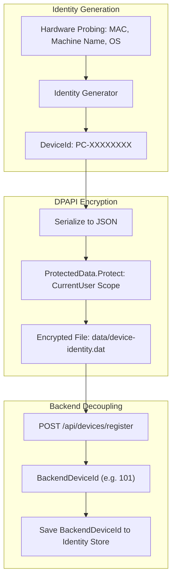

# Module 04: Device Identity & Security Subsystem

## 1. Device Identity Architecture

In a gaming cafe environment, individual stations frequently undergo reboots, guest user logouts, system restores (e.g., Deep Freeze / Reboot Restore Rx), and OS updates. The Client Agent requires a persistent, unique identity that:
1. Survives application restarts.
2. Identifies the PC hardware reliably.
3. Decouples local physical identity from backend database IDs.
4. Protects identity credentials against tampering or cloning.



---

## 2. Hardware Identity Generation (`DeviceIdentityService.cs`)

When the agent starts for the very first time on a new gaming PC, no stored identity exists. `DeviceIdentityService` creates one:

```csharp
public async Task<DeviceIdentity> GetOrCreateIdentityAsync(CancellationToken cancellationToken = default)
{
    // Step 1: Attempt to load from encrypted storage
    var existingIdentity = await _store.LoadIdentityAsync(cancellationToken);
    if (existingIdentity != null && existingIdentity.IsValid())
    {
        // Refresh dynamic network info (IP might have changed via DHCP)
        existingIdentity.IpAddress = GetPrimaryIpAddress();
        await _store.SaveIdentityAsync(existingIdentity, cancellationToken);
        return existingIdentity;
    }

    // Step 2: Generate deterministic local station identifier
    var newIdentity = new DeviceIdentity
    {
        DeviceId = $"PC-{Guid.NewGuid().ToString("N")[..8].ToUpperInvariant()}",
        DeviceName = Environment.MachineName,
        DeviceType = "GamingStation",
        OperatingSystem = Environment.OSVersion.VersionString,
        MacAddress = GetPrimaryMacAddress(),
        IpAddress = GetPrimaryIpAddress(),
        CreatedAtUtc = DateTime.UtcNow
    };

    await _store.SaveIdentityAsync(newIdentity, cancellationToken);
    return newIdentity;
}
```

### Identifier Format
- Pattern: `PC-{8-HEX-DIGITS}` (e.g., `PC-4F8A2D1B`).
- Uppercase alphanumeric representation for human readability on cafe administrative dashboards.
- Machine name (`Environment.MachineName`) is captured alongside physical hardware addresses (`MAC Address`).

---

## 3. Separation of `DeviceId` and `BackendDeviceId`

An essential architectural pattern in the Client Agent is the clean separation between:
1. **`DeviceId`** (Client-side Unique Identity):
   - A string generated locally (`PC-XXXXXXXX`).
   - Represents the local physical machine installation.
   - Remains immutable across reboots.
2. **`BackendDeviceId`** (Server-side Database Identity):
   - An integer or primary key generated by the PostgreSQL database (`Device.Id = 101`).
   - Returned by the backend in HTTP `201 Created` during registration.
   - Stored alongside the local identity in `DeviceIdentity.BackendDeviceId`.

```csharp
public class DeviceIdentity
{
    public string DeviceId { get; set; } = string.Empty;
    public int? BackendDeviceId { get; set; }  // Separated database ID
    public string DeviceName { get; set; } = string.Empty;
    public string DeviceType { get; set; } = "GamingStation";
    public string MacAddress { get; set; } = string.Empty;
    public string IpAddress { get; set; } = string.Empty;
    public string OperatingSystem { get; set; } = string.Empty;
    public DateTime CreatedAtUtc { get; set; }
}
```

---

## 4. DPAPI Cryptographic Protection (`DpapiCredentialProtection.cs`)

Plaintext storage of identities or tokens on client hard drives is vulnerable to guest tampering or copying across PCs. The Agent utilizes **Windows Data Protection API (DPAPI)**:

```csharp
public class DpapiCredentialProtection : ICredentialProtector
{
    private readonly byte[] _entropy;

    public DpapiCredentialProtection(byte[]? optionalEntropy = null)
    {
        // Salt / entropy to prevent dictionary attacks across users
        _entropy = optionalEntropy ?? Encoding.UTF8.GetBytes("GamingCafe-ClientAgent-v1-Salt");
    }

    public byte[] Protect(byte[] plaintext)
    {
        ArgumentNullException.ThrowIfNull(plaintext);
        return ProtectedData.Protect(
            plaintext, 
            _entropy, 
            DataProtectionScope.CurrentUser);
    }

    public byte[] Unprotect(byte[] ciphertext)
    {
        ArgumentNullException.ThrowIfNull(ciphertext);
        return ProtectedData.Unprotect(
            ciphertext, 
            _entropy, 
            DataProtectionScope.CurrentUser);
    }
}
```

### Why DPAPI?
1. **Hardware & User Binding**: The encryption key is derived by Windows from the local user account credentials and local machine master key.
2. **Zero Hardcoded Secrets**: No encryption keys are stored in source code or `appsettings.json`.
3. **Copy-Proof**: If a malicious user copies `device-identity.dat` to another PC, DPAPI decryption on the target PC fails immediately because the master machine key differs.

---

## 5. Tamper Detection & Corruption Quarantine

If `device-identity.dat` is modified, truncated, or copied from another machine, DPAPI throws a `CryptographicException`. Rather than crashing, the agent isolates the corrupt file and recovers cleanly:

```csharp
public async Task<DeviceIdentity?> LoadIdentityAsync(CancellationToken cancellationToken = default)
{
    if (!File.Exists(_identityFilePath)) return null;

    try
    {
        byte[] encryptedBytes = await File.ReadAllBytesAsync(_identityFilePath, cancellationToken);
        byte[] decryptedBytes = _protector.Unprotect(encryptedBytes);
        string json = Encoding.UTF8.GetString(decryptedBytes);
        return JsonSerializer.Deserialize<DeviceIdentity>(json);
    }
    catch (CryptographicException ex)
    {
        _logger.LogError(ex, "DPAPI decryption failed for device identity. Quarantining corrupted file.");
        QuarantineCorruptFile(_identityFilePath);
        return null; // Triggers fresh identity generation
    }
}

private void QuarantineCorruptFile(string filePath)
{
    string quarantinePath = $"{filePath}.corrupt.{DateTime.UtcNow:yyyyMMddHHmmss}";
    try
    {
        File.Move(filePath, quarantinePath, overwrite: true);
        _logger.LogWarning("Corrupt identity moved to: {QuarantinePath}", quarantinePath);
    }
    catch (Exception ex)
    {
        _logger.LogError(ex, "Failed to quarantine file: {FilePath}", filePath);
    }
}
```

---

## 6. Secure Credential Store (`SecureCredentialStore.cs`)

In addition to hardware identity, the agent stores server session tokens and credentials via `SecureCredentialStore`:
- Encrypted with DPAPI on disk at `data/device-credentials.dat`.
- Cached in memory using thread-safe primitives.
- Cleared from memory and disk upon session expiration or logout.
