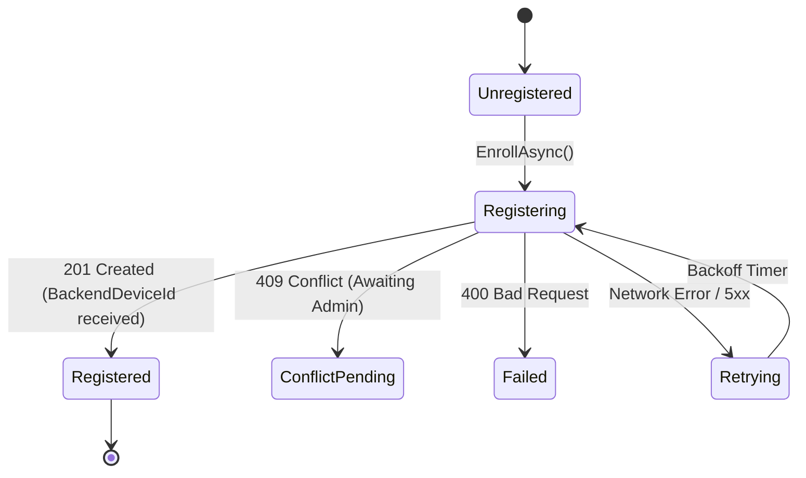

# Module 05: Backend API Integration & Device Enrollment

## 1. REST API Contract & Overview

The Client Agent interacts with the backend management server (`GamingCafe.Api`) via a dedicated REST client implemented in `BackendApiClient.cs`.

### The Core Registration Contract
- **Endpoint**: `POST /api/devices/register`
- **Content-Type**: `application/json`
- **Request DTO (`DeviceRegistrationRequest`)**:
```json
{
  "deviceName": "PC-GAMING-01",
  "ipAddress": "192.168.1.105",
  "macAddress": "00:1A:2B:3C:4D:5E",
  "deviceType": "GamingStation"
}
```

- **Backend Controller Implementation**:
The backend's `DevicesController.cs` receives this payload and validates whether a device with the same `DeviceName` exists in the database.
- If new: creates the record, sets status to `PendingApproval`, and returns **HTTP 201 Created**.
- If exists: returns **HTTP 409 Conflict** with message `"Device name already exists."`

---

## 2. Response Status Code Handling

The table below defines how `BackendApiClient` processes each HTTP status code returned by the backend:

| HTTP Status | Meaning from Backend | Client Agent Action & State Transition |
| :--- | :--- | :--- |
| **`201 Created`** | Registration succeeded. Device assigned database ID. | Parses `DeviceRegistrationResponse`. Stores `BackendDeviceId` (e.g., `101`) in DPAPI storage. Sets status to `Registered` / `PendingApproval`. |
| **`409 Conflict`** | Device name already registered in database. | **CRITICAL SECURITY RULE**: Do NOT treat as approved or authenticated. Log warning that device name is already registered. Retain existing local identity without overwriting. |
| **`400 Bad Request`** | Invalid payload (e.g., missing name or MAC). | Logs validation error. Returns failed enrollment result. Agent does not retry indefinitely without config correction. |
| **`Timeout / 5xx`** | Backend server offline or database unreachable. | Retries with exponential backoff (`ReconnectionService`). Keeps local station running. |

---

## 3. Strict 409 Conflict Security Rule

> [!CAUTION]
> **A `409 Conflict` response does NOT grant device approval or authentication.**
> A `409 Conflict` simply indicates that a database row with the same name exists. In an untrusted network, an attacker could spoof a PC name. If the agent treated 409 as "already approved", it would bypass administrative authorization!
> The agent strictly logs the conflict, leaves the station in an unapproved/dormant state, and awaits administrator resolution in the cafe management portal.

---

## 4. `DeviceEnrollmentService.cs` Implementation

`DeviceEnrollmentService` coordinates the lifecycle transitions:



### Source Code Excerpt
```csharp
public async Task<EnrollmentResult> EnrollAsync(DeviceIdentity identity, CancellationToken cancellationToken = default)
{
    ArgumentNullException.ThrowIfNull(identity);

    // If already registered with a valid BackendDeviceId, skip redundant registration
    if (identity.BackendDeviceId.HasValue && identity.BackendDeviceId.Value > 0)
    {
        _logger.LogInformation("Device already enrolled with BackendDeviceId: {BackendDeviceId}", 
            identity.BackendDeviceId.Value);
        return EnrollmentResult.Success(identity.BackendDeviceId.Value);
    }

    _logger.LogInformation("Initiating device registration for {DeviceName} ({DeviceId})...",
        identity.DeviceName, identity.DeviceId);

    var request = new DeviceRegistrationRequest
    {
        DeviceName = identity.DeviceName,
        DeviceType = identity.DeviceType,
        IpAddress = identity.IpAddress,
        MacAddress = identity.MacAddress
    };

    var response = await _apiClient.RegisterDeviceAsync(request, cancellationToken);

    if (response.StatusCode == HttpStatusCode.Created && response.Data != null)
    {
        identity.BackendDeviceId = response.Data.Id;
        await _identityStore.SaveIdentityAsync(identity, cancellationToken);
        _logger.LogInformation("Registration successful! Assigned BackendDeviceId: {Id}", response.Data.Id);
        return EnrollmentResult.Success(response.Data.Id);
    }
    else if (response.StatusCode == HttpStatusCode.Conflict)
    {
        _logger.LogWarning("Registration conflict: Device name {DeviceName} already exists in backend. " +
                           "Requires administrator approval.", identity.DeviceName);
        return EnrollmentResult.Conflict("Device name already registered in backend.");
    }

    return EnrollmentResult.Failure($"Registration failed: {response.StatusCode} - {response.ErrorMessage}");
}
```

---

## 5. Preventing Socket Exhaustion with `HttpClient`
In `BackendApiClient.cs`, `HttpClient` is injected via `IHttpClientFactory` or registered as a singleton instance configured with appropriate socket handlers:
- `PooledConnectionLifetime = TimeSpan.FromMinutes(5)`
- `Timeout = TimeSpan.FromSeconds(10)`
- `ServerCertificateCustomValidationCallback` tied to `ISecurityValidationService`.
This avoids the classic .NET `TIME_WAIT` socket exhaustion bug under network instability.
