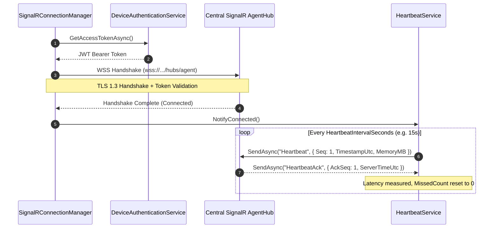

# Module 06: SignalR WebSocket & Heartbeat Subsystem

## 1. Real-Time Communication Architecture

The Client Agent incorporates a complete, high-performance **SignalR Client** based on `Microsoft.AspNetCore.SignalR.Client`. It is designed for bi-directional, full-duplex communication over **Secure WebSockets (`wss://`)**.



---

## 2. Secure SignalR Client (`SignalRConnectionManager.cs`)

`SignalRConnectionManager` builds and maintains the `HubConnection`:

```csharp
public async Task InitializeConnectionAsync(CancellationToken cancellationToken = default)
{
    var config = _configurationService.GetConfiguration();

    var builder = new HubConnectionBuilder()
        .WithUrl(config.HubUrl, options =>
        {
            options.Transports = HttpTransportType.WebSockets;
            options.SkipNegotiation = true; // Direct WebSocket connect

            // JWT Access Token Provider
            options.AccessTokenProvider = async () =>
            {
                var creds = await _authService.GetCredentialsAsync();
                return creds?.AccessToken;
            };

            // TLS Certificate Validation Callback
            if (!config.ValidateServerCertificate)
            {
                // Permitted only in Development environment
                options.WebSocketConfiguration = wsc =>
                {
                    wsc.RemoteCertificateValidationCallback = (sender, cert, chain, errors) => true;
                };
            }
        });

    _hubConnection = builder.Build();
    RegisterHubEventHandlers();
}
```

### Key Security & Performance Settings
1. **`HttpTransportType.WebSockets`**: Forces WebSockets only, disabling Long Polling or Server-Sent Events to minimize overhead and latency.
2. **`SkipNegotiation = true`**: Skips the initial HTTP negotiation request when connecting directly to WebSockets, eliminating an extra HTTP round trip.
3. **`AccessTokenProvider`**: Invoked automatically by SignalR prior to every handshake and reconnection, ensuring refreshed JWT tokens are always presented.

---

## 3. Heartbeat & Health Monitoring (`HeartbeatService.cs`)

To detect silently dropped TCP connections (e.g., router reboots, cable disconnections, firewall drops), the agent runs an active ping/pong heartbeat loop.

### Monotonic Sequence Tracking
Each heartbeat payload increments a monotonic `long SequenceNumber`:
```csharp
public class HeartbeatMessage
{
    public long SequenceNumber { get; set; }
    public string DeviceId { get; set; } = string.Empty;
    public DateTime SentAtUtc { get; set; }
    public long WorkingSetBytes { get; set; }
}

public class HeartbeatAcknowledgment
{
    public long AcknowledgedSequenceNumber { get; set; }
    public DateTime ServerTimeUtc { get; set; }
}
```

### ACK Timeout & Threshold Recovery
- When a heartbeat is sent, `_lastHeartbeatSentUtc` is recorded.
- When the backend replies with `HeartbeatAck`, the round-trip latency is computed:
  $$\text{Latency} = T_{\text{Received}} - T_{\text{Sent}}$$
- If consecutive unacknowledged heartbeats exceed `MaxMissedHeartbeats` (default: 3), the connection is presumed dead.
- `HeartbeatService` immediately calls `ISignalRConnectionManager.RestartConnectionAsync()`.

---

## 4. Exponential Backoff & Full Jitter (`ReconnectionService.cs`)

When network failures occur, reconnecting on a fixed timer causes the **Thundering Herd Problem**, where hundreds of gaming PCs hammer the backend at the exact same second.

The Client Agent implements **Full Jitter Exponential Backoff**:

$$\text{Sleep} = \text{Random}(0, \min(M, B \times 2^{\text{attempt}}))$$

```csharp
public TimeSpan CalculateBackoff(int attempt, TimeSpan baseDelay, TimeSpan maxDelay)
{
    // Exponential calculation: baseDelay * 2^(attempt - 1)
    double exponentialSeconds = baseDelay.TotalSeconds * Math.Pow(2, Math.Max(0, attempt - 1));
    double cappedSeconds = Math.Min(maxDelay.TotalSeconds, exponentialSeconds);

    // Full Jitter: randomize between 0 and capped value
    double jitteredSeconds = Random.Shared.NextDouble() * cappedSeconds;

    return TimeSpan.FromSeconds(Math.Max(baseDelay.TotalSeconds, jitteredSeconds));
}
```

### Connection Error Classification (`ConnectionErrorClassifier.cs`)
Errors are classified into actionable categories:
- **`Transient`**: Socket connection refused, network timeout, DNS glitch $\rightarrow$ Retry with exponential backoff.
- **`Terminal`**: 401 Unauthorized, invalid TLS certificate, rejected handshake $\rightarrow$ Abort retry loop and notify administrator.

---

## 5. Current Operational Status: Dormant (`EnableSignalR: false`)

In `appsettings.json` and `appsettings.Development.json`, `EnableSignalR` is set to `false`:
```json
{
  "AgentConfiguration": {
    "EnableSignalR": false,
    "HubUrl": "wss://localhost:7267/hubs/agent"
  }
}
```

### Why is SignalR Dormant?
The central backend team has not yet implemented `/hubs/agent` (the SignalR Hub) in `GamingCafe.Api`. 
Keeping `EnableSignalR: false` allows the Client Agent to run flawlessly in production for device identity and REST registration without generating continuous `System.Net.WebSockets.WebSocketException` connection-refused errors in logs. Once the backend deploys `AgentHub`, setting `EnableSignalR: true` immediately activates real-time capability without any code changes!
