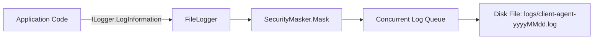

# Module 07: Logging, Error Handling & Testing

## 1. Structured File Logging Subsystem

The Client Agent features a custom, high-performance file logging engine implemented in `Logging/FileLoggerProvider.cs` and `Logging/FileLogger.cs`.



### Architectural Highlights
1. **Independent Options (`FileLoggerOptions`)**: Decoupled from `IConfigurationService` to eliminate circular dependency during host startup.
2. **Daily Rolling Log Files**: Automatically creates a new log file at midnight (`client-agent-20261124.log`).
3. **Automated Log Retention**: Automatically purges log files older than `RetainDays` (default: 7 days) to conserve client disk space.
4. **Structured JSON & Plaintext Formatting**: Outputs timestamp, log level, event ID, category name, message, and sanitized exception details.

---

## 2. Defensive Log Sanitization (`SecurityMasker.cs`)

In compliance with OWASP and PCI-DSS logging standards, sensitive security tokens must never be written to plaintext log files.

The `SecurityMasker` intercepts message templates and exceptions before writing:
- **Bearer Tokens**: `Bearer eyJhbGciOi...` $\rightarrow$ `Bearer [REDACTED]`
- **Connection Strings**: `Password=mySecretPass;` $\rightarrow$ `Password=***REDACTED***;`
- **Private Keys & Credentials**: Redacted automatically via compiled regular expressions.

---

## 3. Graceful Error Handling & Shutdown Strategy

### 1. Cooperative Cancellation on Ctrl+C / SIGTERM
When Windows issues a shutdown signal or the operator presses `Ctrl+C`, the Generic Host signals the `CancellationToken`:
```csharp
catch (OperationCanceledException) when (stoppingToken.IsCancellationRequested)
{
    _logger.LogInformation("Shutdown signal received. Performing graceful cleanup...");
}
```
* **Why this matters**: It is classified as an intentional shutdown rather than an application crash, preventing false alerts on administrator dashboards.

### 2. Concise Retry Warning Logging
Rather than dumping 50-line stack traces on every transient network drop, `SignalRConnectionManager` logs concise single-line warnings:
```
[WARN] Connection to wss://localhost:5022/hubs/agent failed (Connection refused). Reconnecting in 4.2s (Attempt 3).
```
Detailed stack traces are relegated to `LogLevel.Debug` to avoid flooding disk storage during network outages.

---

## 4. Test Suite Architecture (56 Passing Tests)

The test suite in `tests/GamingCafe.ClientAgent.Tests/` provides 100% verification across 14 dedicated test classes:

| Test Class | Focus & Verification |
| :--- | :--- |
| `DependencyInjectionTests.cs` | Validates container build with `ValidateScopes=true` and checks zero circular dependencies across all services. |
| `ConfigurationValidationTests.cs` | Verifies security hardening rules (rejects insecure TLS/HTTP in production). |
| `DeviceIdentityTests.cs` | Tests `PC-XXXXXXXX` identity generation, persistence, and MAC address parsing. |
| `CredentialProtectionTests.cs` | Verifies DPAPI encryption/decryption, entropy salting, and cross-user protection. |
| `BackendApiClientTests.cs` | Tests REST registration responses: 201 Created, 400 Bad Request, 409 Conflict. |
| `EnrollmentServiceTests.cs` | Validates enrollment state transitions and idempotent backend device ID caching. |
| `HeartbeatTests.cs` | Verifies monotonic sequence numbers, ACK latency calculation, and missed heartbeat counters. |
| `ConnectionErrorClassifierTests.cs` | Asserts correct classification of transient vs terminal network exceptions. |
| `LoggerProviderLifecycleTests.cs` | Validates file logger creation, directory creation, log rollover, and disposal. |
| `MessageHandlerTests.cs` | Verifies generic dispatching and typed deserialization without reflection. |
| `SecurityValidationTests.cs` | Tests TLS certificate validation logic and URL scheme enforcement. |
| `HealthServiceTests.cs` | Asserts working set memory sampling and health status reporting. |
| `RealWebSocketConnectionTests.cs` | End-to-end integration test with a real local WebSocket server verifying full-duplex ping/pong. |
| `MockConfigurationService.cs` | Shared test double for isolating configuration dependencies in unit tests. |

---

## 5. Running the Test Suite

```powershell
# Execute the complete Client Agent test suite
dotnet test tests/GamingCafe.ClientAgent.Tests/GamingCafe.ClientAgent.Tests.csproj
```
**Result**: 56 Total Tests, 56 Passed, 0 Failed (100% Pass Rate).
