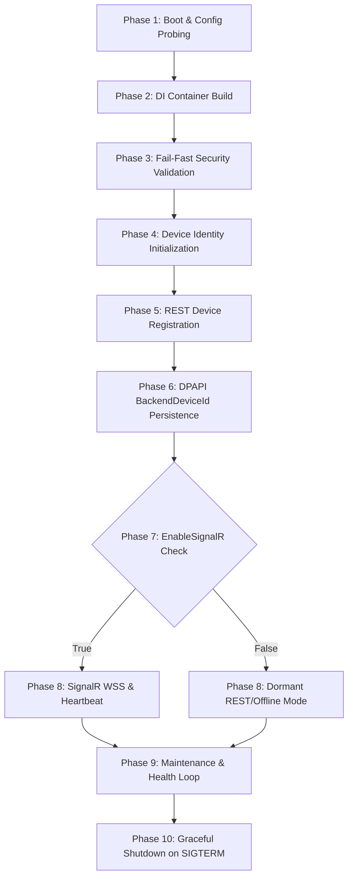
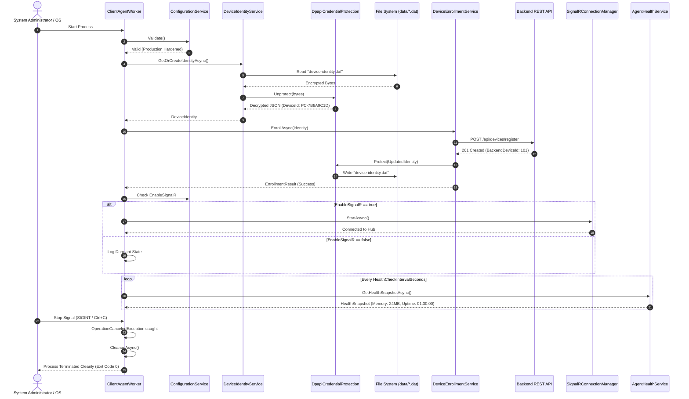

# Module 08: Complete Runtime Execution Flow

## 1. End-to-End Execution Lifecycle

The lifecycle of the Gaming Cafe Client Agent progresses through 10 distinct phases from execution startup to process termination.

---

## 2. Phase-by-Phase Breakdown

### Phase 1: Bootstrapping & Configuration Probing
- When `dotnet GamingCafe.ClientAgent.dll` is launched, `Program.cs` resolves the environment name (`DOTNET_ENVIRONMENT` or fallback to `Production`).
- **Candidate Path Probing**: Because the working directory may vary depending on whether the agent runs as a console app, a Windows Service, or from an IDE, `Program.cs` probes multiple candidate directories (`AppContext.BaseDirectory`, `Directory.GetCurrentDirectory()`, parent folders) to ensure `appsettings.json` and `appsettings.Development.json` are reliably located.

### Phase 2: Host & Dependency Injection Composition
- The Generic Host builds the `IServiceCollection`.
- `FileLoggerOptions` is bound directly from configuration and added via `logging.AddProvider(new FileLoggerProvider(options))`, completely avoiding circular DI loops.
- All singletons and hosted services are registered.
- The service provider is validated with `ValidateScopes: true` and `ValidateOnBuild: true`.

### Phase 3: Fail-Fast Security Validation
- `ClientAgentWorker.ExecuteAsync` commences.
- `ConfigurationValidator.Validate(config, environment)` executes.
- If in `Production` and TLS verification is disabled or HTTP URLs are configured, execution terminates immediately via `_lifetime.StopApplication()`.

### Phase 4: Device Identity Initialization
- `DeviceIdentityService.GetOrCreateIdentityAsync()` checks for `data/device-identity.dat`.
- If found: decrypts via DPAPI (`DataProtectionScope.CurrentUser`), verifies integrity, and updates current local IP address.
- If corrupt or missing: quarantines corrupt file and generates a fresh identity (`PC-{8-HEX}`).

### Phase 5 & 6: REST Device Registration & Persistence
- `DeviceEnrollmentService.EnrollAsync()` prepares `DeviceRegistrationRequest`.
- Executes HTTP `POST /api/devices/register` to `ApiBaseUrl` (e.g., `http://localhost:5022` or `https://backend.gamingcafe.com`).
- On `201 Created`: receives `{ id: 101, deviceName: "...", status: "PendingApproval" }`.
- Sets `DeviceIdentity.BackendDeviceId = 101`.
- Encrypts and writes updated identity back to disk via DPAPI.
- On `409 Conflict`: logs that device name exists; does NOT overwrite identity and does NOT treat as authenticated.

### Phase 7 & 8: SignalR Connection Evaluation
- Inspects `config.EnableSignalR`.
- **If `false`** (current configuration): logs that SignalR is dormant, operating in REST-only mode.
- **If `true`**: invokes `SignalRConnectionManager.StartAsync()`, establishes TLS WSS socket, and triggers `HeartbeatService.StartAsync()` to begin 15-second ping/pong cycles.

### Phase 9: Continuous Health & Maintenance Loop
- Loops until `stoppingToken.IsCancellationRequested`.
- Periodically queries `AgentHealthService` for memory footprint (Working Set bytes), uptime, and connectivity state.
- Emits debug diagnostics and sleeps for `HealthCheckIntervalSeconds`.

### Phase 10: Graceful Shutdown
- Upon `Ctrl+C` or Windows Service Stop command, `stoppingToken` cancels.
- `OperationCanceledException` is caught gracefully.
- Socket connections close cleanly with `WebSocketCloseStatus.NormalClosure`.
- In-memory credentials and file handles are flushed.
- Process exits with code 0.

---

## 3. Complete Runtime Sequence Diagram

