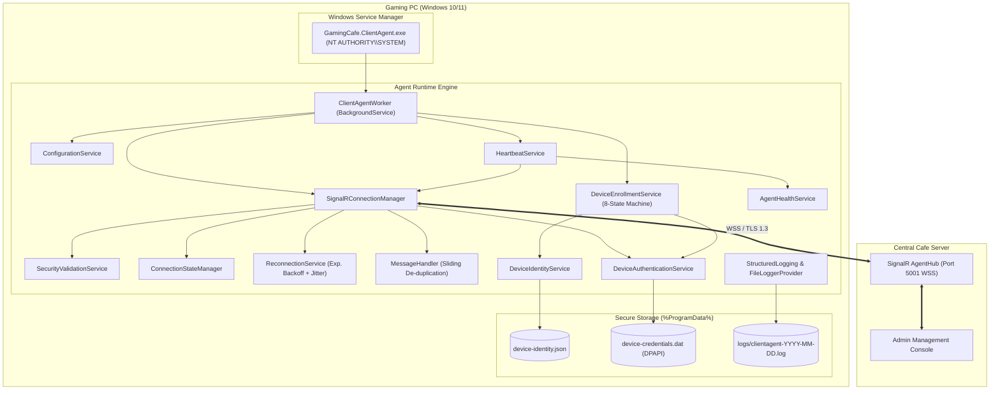
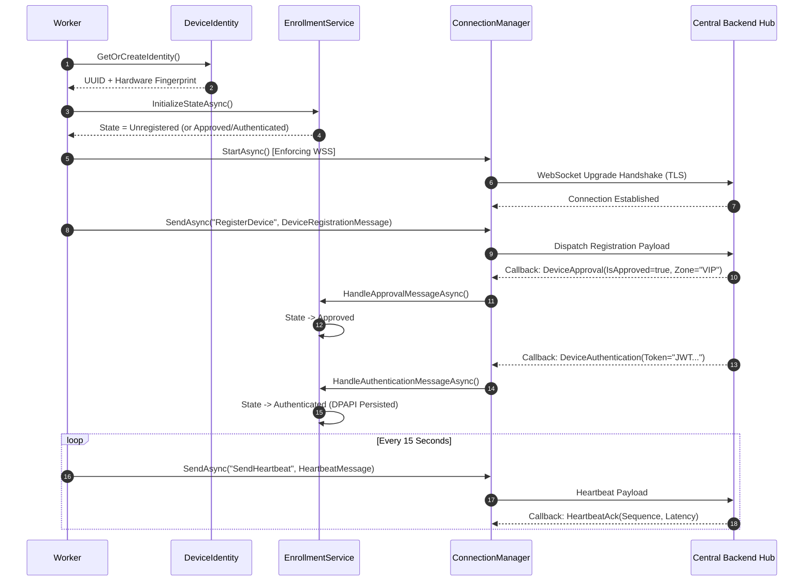

# Gaming Cafe Client Agent — System Architecture

## 1. High-Level Design

The Gaming Cafe Client Agent operates as an autonomous, event-driven background service. It establishes an outbound-only WebSocket connection to the central server, eliminating the need to expose inbound network ports on gaming PCs.

---

## 2. Component Interaction & Sequence Flow

### Startup and Enrollment Sequence

---

## 3. Resilience and Self-Healing Strategy

1. **Connection Loss**:
   When the connection drops, `SignalRConnectionManager` delegates to `ReconnectionService`. Reconnection attempts are spaced with exponential backoff:
   $$\text{Delay} = \min(\text{MaxDelay}, \text{InitialDelay} \times 2^{\text{attempt}-1}) + \text{crypto\_jitter}$$
2. **Process Failure**:
   Configured in Windows Service Control Manager with recovery actions:
   - 1st Failure: Restart service after 5,000 ms.
   - 2nd Failure: Restart service after 10,000 ms.
   - Subsequent Failures: Restart service after 30,000 ms (reset period: 86,400s).
3. **Storage Corruption**:
   `DeviceIdentityStore` writes through temporary staging files (`.tmp.<guid>`) and verifies deserialization. Any corrupted file is automatically quarantined (`.corrupted.<timestamp>`) and replaced with a clean GUID identity.
